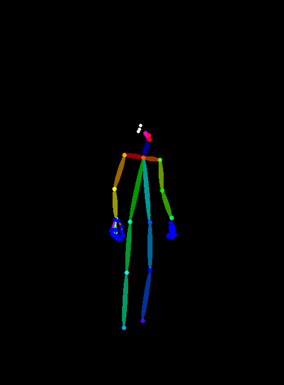
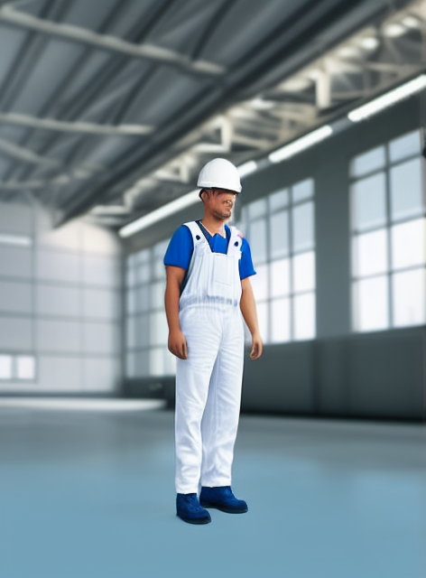
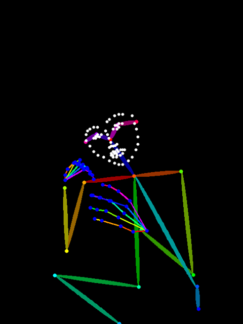

# 원하는 포즈로 이미지 만드는 도구

## 도구 설명
- 사진 속 사람 자세를 OpenPose로 뽑아서 막대 인형으로 만들고, 그걸 ControlNet 조건으로 넣어서 같은 자세의 다른 인물을 만드는 도구
- 모델: Stable Diffusion 1.5 + ControlNet v1.1 OpenPose (무료 Colab T4에서 한 장에 6~8초)
- 이 모델 고른 이유: FLUX.2는 공식 포즈 ControlNet이 없고 커뮤니티 버전은 무료 T4엔 무거워서, 과제에서 허용한 "비슷한 모델"로 감

## 사용법
1. `pose_tool.ipynb`를 Colab에서 열기
2. 런타임 → 런타임 유형 변경 → T4 GPU
3. 위에서부터 셀 순서대로 실행하고, 안내 나오면 자세 다른 사진 2장 올리기
4. 결과는 `samples/`에 저장되고, 쓴 프롬프트·시드·모델은 `samples/log.json`에 기록됨

## 테스트 결과
| 포즈 | 결과 |
|---|---|
|  |  |
|  |  |

- 포즈 1: 똑바로 서서 팔 내린 자세 → 프롬프트: 하얀 안전모 쓴 공장 작업자 → 결과: 자세는 그대로 맞음. 근데 파란 작업복이라고 했는데 작업복은 하얗고 셔츠가 파랗게 나옴
- 포즈 2: 바닥에 앉아서 폰 들고 있는 자세 → 프롬프트: 같은 거 → 결과: 앉은 자세, 고개 기울인 거까지 맞음. 근데 하얀 안전모가 파랗게 나오고, 안 시킨 폰이 손에 생김
- 같은 포즈에 프롬프트만 바꾼 결과(우주인/기사/요리사)는 `samples/exp_a_*.png`, 포즈 세기 바꾼 결과는 `samples/exp_c_*.png`

## 한계
- 사람이 작거나 역광인 사진은 관절을 못 찾아서 막대 인형이 까맣게 나옴
- 손이나 폰이 얼굴을 가리면 얼굴 점이 엉클어지고, 사진에서 잘린 다리는 한쪽만 잡힘
- 색 지시(흰 안전모, 파란 작업복)가 엉뚱한 옷에 붙는 일이 많음
- 프롬프트를 77토큰까지만 읽어서 길게 쓰면 뒤가 잘림
- 자세한 관찰은 노트 맨 마지막 셀에 있음
